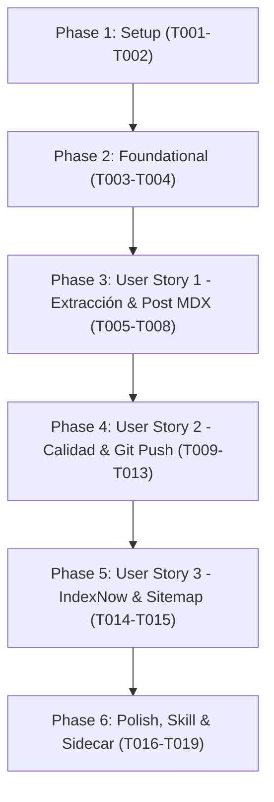

# Tasks: Automatización de post de análisis de inflación y tasas de interés con publicación e indexación automática

**Input**: Design documents from `specs/004-automatizacion-post-inflacion/`  
**Prerequisites**: `plan.md`, `spec.md`, `data-model.md`, `contracts/`, `quickstart.md`

---

## Phase 1: Setup (Shared Infrastructure)

**Purpose**: Verificación de herramientas y entorno base

- [X] T001 Verificar entorno Node >= 22.12 y dependencias instaladas en package.json
- [X] T002 [P] Validar que public/data/data_inflacion.json contenga estructura íntegra con corte 2026-09

---

## Phase 2: Foundational (Extractor determinista de hechos)

**Purpose**: Módulo central que alimenta todas las etapas sin margen de error numérico

- [X] T003 Implementar el script extractor de hechos en scripts/extract-inflacion-facts.mjs siguiendo el contrato contracts/inflation-facts-schema.json
- [X] T004 [P] Validar la ejecución y consistencia de datos de scripts/extract-inflacion-facts.mjs con corte 2026-09

---

## Phase 3: User Story 1 - Detección y redacción analítica determinista con portada (Priority: P1) 🎯 MVP

**Goal**: Generar automáticamente la portada visual de 1200x630 y el post MDX con cifras y análisis exactos para el corte mensual detectado.

**Independent Test**: Ejecutar `node scripts/extract-inflacion-facts.mjs` y `node scripts/build-inflacion-cover-hero.mjs`, y verificar que el archivo `src/content/blog/inflacion-tasas-interes-colombia-septiembre-2026.mdx` sea creado con sus componentes y datos reales.

### Implementation for User Story 1

- [X] T005 [P] [US1] Parametrizar y verificar la generación de portada en scripts/build-inflacion-cover-hero.mjs para sincronización con el periodo de data_inflacion.json
- [X] T006 [P] [US1] Generar la imagen de portada OpenGraph 1200x630 en public/images/blog/inflacion-tasas-colombia-septiembre-2026-cover.png
- [X] T007 [US1] Redactar el post analítico en src/content/blog/inflacion-tasas-interes-colombia-septiembre-2026.mdx siguiendo contracts/post-structure.md y la Ficha de Hechos
- [X] T008 [US1] Actualizar el post anterior en src/content/blog/inflacion-tasas-interes-colombia-agosto-2026.mdx para establecer destacado: false

**Checkpoint**: User Story 1 completa y funcional de forma autónoma.

---

## Phase 4: User Story 2 - Verificación de calidad, compilación y despliegue autónomo en Git (Priority: P2)

**Goal**: Validar tipos, compilar en modo estricto sin enlaces rotos y realizar commit y push autónomos a `main`.

**Independent Test**: Correr `npx astro check` y `npm run build`; si ambos pasan con 0 errores, ejecutar `git commit` y `git push origin main`.

### Implementation for User Story 2

- [X] T009 [US2] Ejecutar verificación estricta de tipos de Astro con ASTRO_TELEMETRY_DISABLED=1 npx astro check
- [X] T010 [US2] Ejecutar compilación de producción con ASTRO_TELEMETRY_DISABLED=1 npm run build y validar 0 enlaces rotos en scripts/check-internal-links.mjs
- [X] T011 [US2] Ejecutar sincronización previa con git pull --rebase origin main
- [X] T012 [US2] Registrar los artefactos generados con git add y realizar commit semántico feat(blog): publicar informe de inflacion septiembre 2026
- [X] T013 [US2] Desplegar a producción ejecutando git push origin main

**Checkpoint**: User Story 2 completa: cambios desplegados a GitHub Pages vía GitHub Actions.

---

## Phase 5: User Story 3 - Notificación de indexación automática en motores de búsqueda (Priority: P3)

**Goal**: Acelerar el rastreo e indexación del nuevo artículo notificando a Bing/Yandex vía IndexNow e integrando en sitemap para Google Search Console.

**Independent Test**: Enviar la URL canónica del post a `https://api.indexnow.org/indexnow` y confirmar respuesta HTTP 200/202, verificando además la URL en el sitemap de producción.

### Implementation for User Story 3

- [X] T014 [US3] Notificar la nueva URL canónica a Bing y Yandex ejecutando scripts/indexnow-submit.mjs https://fredericksalazar.github.io/blog/inflacion-tasas-interes-colombia-septiembre-2026/
- [X] T015 [US3] Verificar que dist/sitemap-0.xml y dist/sitemap-index.xml contengan la nueva URL del post de septiembre con lastmod actualizado

**Checkpoint**: User Story 3 completa: URL encolada para indexación rápida.

---

## Phase 6: Polish, Skill & Scheduled Automation

**Purpose**: Empaquetamiento de la skill del proyecto, automatización programada y documentación viva

- [X] T016 [P] Crear la skill del proyecto en .agents/skills/publicar-informe-inflacion/SKILL.md
- [X] T017 [P] Crear el espejo de la skill en .claude/skills/publicar-informe-inflacion/SKILL.md
- [X] T018 Configurar la automatización programada en ~/.gemini/config/sidecars/auto-informe-inflacion/sidecar.json
- [X] T019 Actualizar la documentación de arquitectura en agents/ARCHITECTURE.md documentando el flujo automatizado y scripts

---

## Dependencies & Execution Order

### Parallel Opportunities

- **T001 y T002** pueden ejecutarse en paralelo.
- **T005 y T006** pueden ejecutarse en paralelo con **T007**.
- **T016 y T017** pueden crearse en paralelo.
